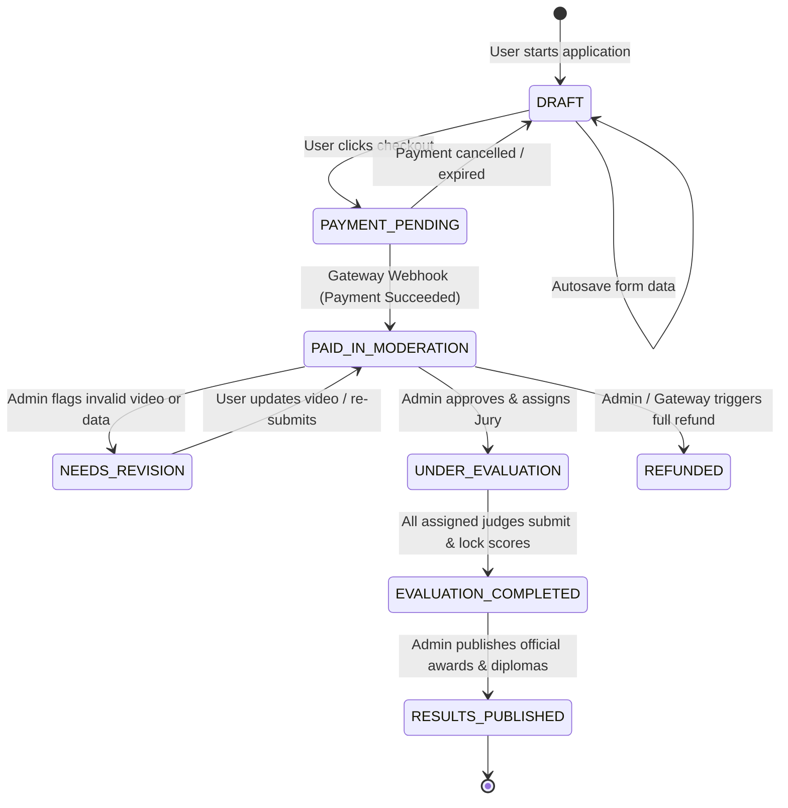
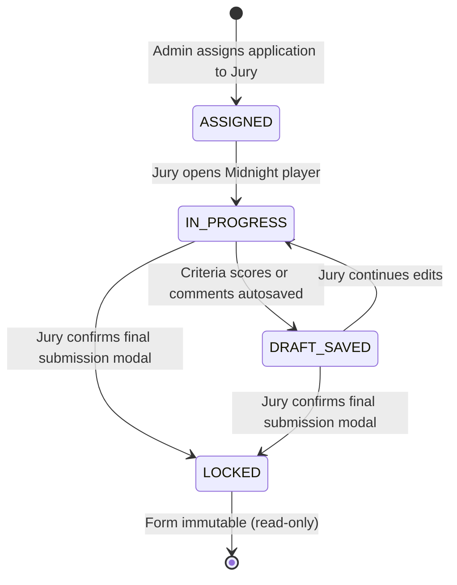
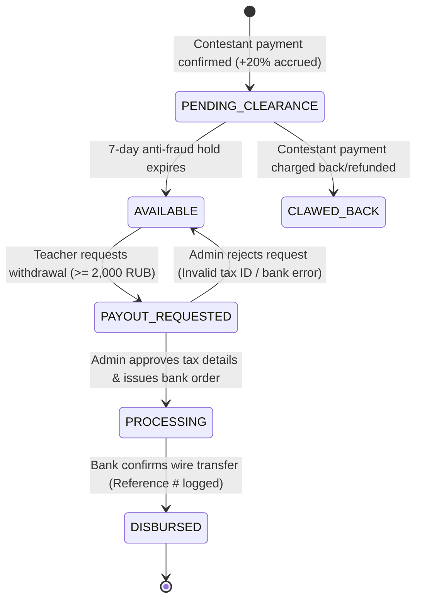

# System Architecture & Technical Specification: espressivo ART
**Platform**: espressivo ART (International Creative Competition Platform)  
**First Flagship Edition**: *espressivo VOCAL — Young Talents*  
**Document Version**: 1.0.0 (Production Architecture Draft)  
**Status**: APPROVED FOR IMPLEMENTATION  
**Author**: Product Architect & Business Analyst  

---

## 1. Architectural Principles & High-Level System Context

### 1.1 Core Principles
1. **Separation of Aesthetics & Experience**: Distinct visual layers optimized for their context:
   - *Public Marketing & Cultural Authority*: Minimalist, museum-grade editorial spread on bone paper (**Art+Commerce** system).
   - *Workspace & High-Density Adjudication*: Midnight projection room with laser-focused media player and rubric sliders (**Frame.io** system).
2. **Zero Minor PII Leakage (Blind Auditioning)**: Adjudication micro-services and database query projections are physically isolated from participant contact info and child demographics.
3. **Double-Entry Financial Immutability**: All teacher commissions (20%) and contestant payments are managed via an append-only double-entry ledger ensuring zero reconciliation drift and idempotent webhook ingestion.
4. **Resilient Asynchronous Processing**: Time-intensive operations (PDF generation, video link health checks, notification blasts) are offloaded to an asynchronous background worker queue.


### 1.3 Database Strategy & Prisma ORM Mapping
In alignment with docs/TECH_STACK.md:
- **Local Development & Review**: Powered by **SQLite (WAL mode)** via **Prisma ORM**, ensuring zero external database dependencies on developer machines (
pm run dev works out of the box).
- **Production Deployment**: Uses the identical Prisma schema migrated to **PostgreSQL 16+** with full support for connection pooling, row-level locks (SELECT FOR UPDATE), and concurrent read replicas.
- **ACID Invariant**: All double-entry ledger operations (ledger_transactions), teacher commission accruals, and application status changes are executed within prisma.() interactive blocks with guaranteed isolation.
### 1.2 C4 Container Architecture Diagram

```
                               ┌──────────────────────────────────────────────┐
                               │                 WEB CLIENTS                  │
                               │  (Mobile, Tablet, Desktop / Safari, Chrome)  │
                               └──────────────────────┬───────────────────────┘
                                                      │ HTTPS / WSS
                                                      ▼
┌────────────────────────────────────────────────────────────────────────────────────────────────────────┐
│                                 ESPRESSIVO PLATFORM BOUNDARY                                          │
│                                                                                                        │
│  ┌──────────────────────────────────────────────────────────────────────────────────────────────────┐  │
│  │                              NEXT.JS APPLICATION LAYER (App Router)                               │  │
│  │                                                                                                  │  │
│  │   ┌────────────────────────┐  ┌────────────────────────┐  ┌──────────────────────────────────┐   │  │
│  │   │  Public Editorial Web  │  │  Creator & Juror Suite │  │  Server Actions & API Handlers   │   │  │
│  │   │   (Art+Commerce UI)    │  │    (Frame.io Dark UI)  │  │   - Zod Validation Gateways      │   │  │
│  │   │   - SSR / Static ISR   │  │    - Authenticated SPA │  │   - RBAC & Blind Projection DTO  │   │  │
│  │   │   - Dual i18n (RU/EN)  │  │    - Real-time Autosave│  │   - Webhook Handlers             │   │  │
│  │   └────────────────────────┘  └────────────────────────┘  └─────────────────┬────────────────┘   │  │
│  └─────────────────────────────────────────────────────────────────────────────┼────────────────────┘  │
│                                                                                │                       │
│                         ┌──────────────────────────────────────────────────────┴──┐                    │
│                         │                                                         │                    │
│                         ▼                                                         ▼                    │
│       ┌──────────────────────────────────┐                      ┌──────────────────────────────────┐   │
│       │    PRIMARY POSTGRESQL CLUSTER    │                      │     REDIS & BULLMQ BROKER        │   │
│       │  - Relational Normalized Data    │                      │  - Session & Rate Limit Store    │   │
│       │  - Double-Entry Financial Ledger │                      │  - Background Async Tasks Queue  │   │
│       │  - Row-Level Security (RLS)      │                      │  - Real-time PubSub / WebSockets │   │
│       └──────────────────────────────────┘                      └─────────────────┬────────────────┘   │
│                                                                                   │                    │
│                                                                                   ▼                    │
│                                                                 ┌──────────────────────────────────┐   │
│                                                                 │     BACKGROUND WORKER NODES      │   │
│                                                                 │  - PDF Diploma Generator Worker  │   │
│                                                                 │  - Video Link Health Monitor     │   │
│                                                                 │  - Email / Notification Worker   │   │
│                                                                 │  - Payout Settlement Processor   │   │
│                                                                 └─────────────────┬────────────────┘   │
│                                                                                   │                    │
│                                                                                   ▼                    │
│                                                                 ┌──────────────────────────────────┐   │
│                                                                 │      OBJECT STORAGE (S3/R2)      │   │
│                                                                 │  - Generated PDF Diplomas        │   │
│                                                                 │  - Contest Banner & Media Assets │   │
│                                                                 │  - Encrypted Audit Evidence      │   │
│                                                                 └──────────────────────────────────┘   │
└────────────────────────────────────────────────────────────────────────────────────────────────────────┘
            │                                 │                                    │
            ▼                                 ▼                                    ▼
┌───────────────────────┐         ┌───────────────────────┐            ┌───────────────────────┐
│   PAYMENT GATEWAYS    │         │  STREAMING PLATFORMS  │            │ NOTIFICATION SERVICE  │
│  - YooKassa (RUB)     │         │  - YouTube / Rutube   │            │  - Transactional Mail │
│  - Stripe (EUR/USD)   │         │  - VK Video / Cloud   │            │  - SMS / Telegram Bot │
└───────────────────────┘         └───────────────────────┘            └───────────────────────┘
```

---

## 2. Complete PostgreSQL Domain Data Model (DDL-Ready)

Below is the normalized relational schema defining the core domain entities, constraints, and audit requirements.

```sql
-- ============================================================================
-- 1. CORE ENUMS & EXTENSIONS
-- ============================================================================
CREATE EXTENSION IF NOT EXISTS "uuid-ossp";
CREATE EXTENSION IF NOT EXISTS "citext";

CREATE TYPE user_role_enum AS ENUM ('PARTICIPANT', 'TEACHER', 'JURY', 'ADMIN');
CREATE TYPE contest_status_enum AS ENUM ('DRAFT', 'REGISTRATION_OPEN', 'REGISTRATION_CLOSED', 'JUDGING_ACTIVE', 'DELIBERATION', 'RESULTS_PUBLISHED', 'ARCHIVED');
CREATE TYPE application_status_enum AS ENUM ('DRAFT', 'PAYMENT_PENDING', 'PAID_IN_MODERATION', 'NEEDS_REVISION', 'UNDER_EVALUATION', 'EVALUATION_COMPLETED', 'RESULTS_PUBLISHED', 'REFUNDED', 'CANCELLED');
CREATE TYPE evaluation_status_enum AS ENUM ('ASSIGNED', 'IN_PROGRESS', 'DRAFT_SAVED', 'LOCKED');
CREATE TYPE award_tier_enum AS ENUM ('GRAND_PRIX', 'LAUREATE_1', 'LAUREATE_2', 'LAUREATE_3', 'DIPLOMANT_1', 'DIPLOMANT_2', 'DIPLOMANT_3', 'PARTICIPANT', 'SPECIAL_PRIZE');
CREATE TYPE transaction_type_enum AS ENUM ('CONTEST_FEE_PAYMENT', 'TEACHER_COMMISSION_ACCRUAL', 'TEACHER_COMMISSION_CLEARANCE', 'PAYOUT_DISBURSEMENT', 'CHARGEBACK_CLAWBACK', 'MANUAL_ADJUSTMENT');
CREATE TYPE payout_status_enum AS ENUM ('PENDING_REVIEW', 'APPROVED', 'PROCESSING', 'DISBURSED', 'REJECTED');
CREATE TYPE tax_status_enum AS ENUM ('SELF_EMPLOYED_NPD', 'INDIVIDUAL_ENTREPRENEUR', 'LEGAL_ENTITY', 'INDIVIDUAL_NON_RESIDENT');

-- ============================================================================
-- 2. USERS & PROFILES
-- ============================================================================
CREATE TABLE users (
    id UUID PRIMARY KEY DEFAULT uuid_generate_v4(),
    email CITEXT UNIQUE NOT NULL,
    password_hash VARCHAR(255) NOT NULL,
    role user_role_enum NOT NULL DEFAULT 'PARTICIPANT',
    is_active BOOLEAN NOT NULL DEFAULT TRUE,
    is_email_verified BOOLEAN NOT NULL DEFAULT FALSE,
    created_at TIMESTAMPTZ NOT NULL DEFAULT NOW(),
    updated_at TIMESTAMPTZ NOT NULL DEFAULT NOW()
);

CREATE TABLE user_profiles (
    user_id UUID PRIMARY KEY REFERENCES users(id) ON DELETE CASCADE,
    first_name VARCHAR(100) NOT NULL,
    last_name VARCHAR(100) NOT NULL,
    phone VARCHAR(30),
    preferred_locale VARCHAR(10) NOT NULL DEFAULT 'ru',
    country VARCHAR(100),
    city VARCHAR(100),
    avatar_url TEXT,
    created_at TIMESTAMPTZ NOT NULL DEFAULT NOW(),
    updated_at TIMESTAMPTZ NOT NULL DEFAULT NOW()
);

CREATE TABLE teacher_profiles (
    teacher_user_id UUID PRIMARY KEY REFERENCES users(id) ON DELETE CASCADE,
    referral_code VARCHAR(32) UNIQUE NOT NULL,
    organization_name VARCHAR(255),
    tax_status tax_status_enum NOT NULL DEFAULT 'SELF_EMPLOYED_NPD',
    tax_id_number VARCHAR(32), -- ИНН
    bank_bik VARCHAR(20),       -- БИК
    bank_account_number VARCHAR(64), -- Расчетный счет
    payout_details JSONB,      -- SBP phone number or card mask
    created_at TIMESTAMPTZ NOT NULL DEFAULT NOW(),
    updated_at TIMESTAMPTZ NOT NULL DEFAULT NOW()
);

-- ============================================================================
-- 3. CONTESTS, NOMINATIONS & AGE CATEGORIES
-- ============================================================================
CREATE TABLE contests (
    id UUID PRIMARY KEY DEFAULT uuid_generate_v4(),
    slug VARCHAR(100) UNIQUE NOT NULL,
    title_ru VARCHAR(255) NOT NULL,
    title_en VARCHAR(255) NOT NULL,
    description_ru TEXT NOT NULL,
    description_en TEXT NOT NULL,
    status contest_status_enum NOT NULL DEFAULT 'DRAFT',
    registration_start_at TIMESTAMPTZ NOT NULL,
    registration_end_at TIMESTAMPTZ NOT NULL,
    judging_start_at TIMESTAMPTZ NOT NULL,
    judging_end_at TIMESTAMPTZ NOT NULL,
    results_published_at TIMESTAMPTZ,
    eligibility_cutoff_date DATE NOT NULL, -- Date used for strict age category calculation
    base_fee_cents INTEGER NOT NULL DEFAULT 250000, -- 2500.00 RUB
    currency VARCHAR(3) NOT NULL DEFAULT 'RUB',
    cover_image_url TEXT,
    created_at TIMESTAMPTZ NOT NULL DEFAULT NOW(),
    updated_at TIMESTAMPTZ NOT NULL DEFAULT NOW()
);

CREATE TABLE nominations (
    id UUID PRIMARY KEY DEFAULT uuid_generate_v4(),
    contest_id UUID NOT NULL REFERENCES contests(id) ON DELETE CASCADE,
    code VARCHAR(50) NOT NULL,
    title_ru VARCHAR(255) NOT NULL,
    title_en VARCHAR(255) NOT NULL,
    is_ensemble BOOLEAN NOT NULL DEFAULT FALSE,
    fee_override_cents INTEGER,
    created_at TIMESTAMPTZ NOT NULL DEFAULT NOW(),
    UNIQUE(contest_id, code)
);

CREATE TABLE age_categories (
    id UUID PRIMARY KEY DEFAULT uuid_generate_v4(),
    contest_id UUID NOT NULL REFERENCES contests(id) ON DELETE CASCADE,
    code VARCHAR(50) NOT NULL,
    title_ru VARCHAR(255) NOT NULL,
    title_en VARCHAR(255) NOT NULL,
    min_age_years INTEGER NOT NULL,
    max_age_years INTEGER NOT NULL,
    created_at TIMESTAMPTZ NOT NULL DEFAULT NOW(),
    UNIQUE(contest_id, code)
);

-- ============================================================================
-- 4. APPLICATIONS & MINOR GUARDIAN CONSENTS
-- ============================================================================
CREATE TABLE guardian_consents (
    id UUID PRIMARY KEY DEFAULT uuid_generate_v4(),
    guardian_full_name VARCHAR(255) NOT NULL,
    guardian_email VARCHAR(255) NOT NULL,
    guardian_phone VARCHAR(50) NOT NULL,
    consent_pii_processing BOOLEAN NOT NULL DEFAULT TRUE,
    consent_public_broadcast BOOLEAN NOT NULL DEFAULT FALSE,
    ip_address INET NOT NULL,
    user_agent TEXT NOT NULL,
    signed_at TIMESTAMPTZ NOT NULL DEFAULT NOW()
);

CREATE TABLE applications (
    id UUID PRIMARY KEY DEFAULT uuid_generate_v4(),
    application_code VARCHAR(32) UNIQUE NOT NULL, -- e.g. VOC-26-0042
    contest_id UUID NOT NULL REFERENCES contests(id),
    nomination_id UUID NOT NULL REFERENCES nominations(id),
    age_category_id UUID NOT NULL REFERENCES age_categories(id),
    applicant_user_id UUID NOT NULL REFERENCES users(id),
    
    -- Contestant Metadata (Hidden from Jury)
    contestant_full_name VARCHAR(255) NOT NULL,
    contestant_birth_date DATE NOT NULL,
    contestant_gender VARCHAR(10),
    institution_name VARCHAR(255),
    teacher_name_display VARCHAR(255),
    country VARCHAR(100) NOT NULL,
    city VARCHAR(100) NOT NULL,
    
    -- Performance Metadata (Visible to Jury)
    repertoire_title VARCHAR(255) NOT NULL,
    repertoire_composer VARCHAR(255) NOT NULL,
    performance_duration_sec INTEGER NOT NULL,
    performance_language VARCHAR(50),
    program_notes TEXT,
    
    -- Video Media Ingestion
    video_url TEXT NOT NULL,
    video_provider VARCHAR(50) NOT NULL, -- 'youtube', 'rutube', 'vk', 'cloud_drive'
    video_is_verified BOOLEAN NOT NULL DEFAULT FALSE,
    
    -- Affiliate Attribution
    referred_by_teacher_id UUID REFERENCES users(id),
    
    -- Legal & State
    guardian_consent_id UUID NOT NULL REFERENCES guardian_consents(id),
    status application_status_enum NOT NULL DEFAULT 'DRAFT',
    fee_cents INTEGER NOT NULL,
    currency VARCHAR(3) NOT NULL DEFAULT 'RUB',
    
    created_at TIMESTAMPTZ NOT NULL DEFAULT NOW(),
    updated_at TIMESTAMPTZ NOT NULL DEFAULT NOW()
);

-- ============================================================================
-- 5. JURY ADJUDICATION & BLIND EVALUATION
-- ============================================================================
CREATE TABLE scoring_criteria (
    id UUID PRIMARY KEY DEFAULT uuid_generate_v4(),
    contest_id UUID NOT NULL REFERENCES contests(id) ON DELETE CASCADE,
    code VARCHAR(50) NOT NULL,
    title_ru VARCHAR(255) NOT NULL,
    title_en VARCHAR(255) NOT NULL,
    max_score INTEGER NOT NULL DEFAULT 25,
    sort_order INTEGER NOT NULL DEFAULT 1,
    created_at TIMESTAMPTZ NOT NULL DEFAULT NOW(),
    UNIQUE(contest_id, code)
);

CREATE TABLE jury_assignments (
    id UUID PRIMARY KEY DEFAULT uuid_generate_v4(),
    application_id UUID NOT NULL REFERENCES applications(id) ON DELETE CASCADE,
    jury_user_id UUID NOT NULL REFERENCES users(id) ON DELETE CASCADE,
    assigned_by_admin_id UUID NOT NULL REFERENCES users(id),
    created_at TIMESTAMPTZ NOT NULL DEFAULT NOW(),
    UNIQUE(application_id, jury_user_id)
);

CREATE TABLE evaluations (
    id UUID PRIMARY KEY DEFAULT uuid_generate_v4(),
    application_id UUID NOT NULL REFERENCES applications(id) ON DELETE CASCADE,
    jury_user_id UUID NOT NULL REFERENCES users(id) ON DELETE CASCADE,
    status evaluation_status_enum NOT NULL DEFAULT 'ASSIGNED',
    total_score NUMERIC(5,2) DEFAULT 0,
    strengths_feedback TEXT,
    growth_feedback TEXT,
    submitted_at TIMESTAMPTZ,
    locked_at TIMESTAMPTZ,
    created_at TIMESTAMPTZ NOT NULL DEFAULT NOW(),
    updated_at TIMESTAMPTZ NOT NULL DEFAULT NOW(),
    UNIQUE(application_id, jury_user_id)
);

CREATE TABLE evaluation_criteria_scores (
    id UUID PRIMARY KEY DEFAULT uuid_generate_v4(),
    evaluation_id UUID NOT NULL REFERENCES evaluations(id) ON DELETE CASCADE,
    criterion_id UUID NOT NULL REFERENCES scoring_criteria(id) ON DELETE CASCADE,
    score INTEGER NOT NULL CHECK (score >= 0),
    UNIQUE(evaluation_id, criterion_id)
);

-- ============================================================================
-- 6. OFFICIAL RESULTS & VERIFIABLE DIPLOMAS
-- ============================================================================
CREATE TABLE official_results (
    id UUID PRIMARY KEY DEFAULT uuid_generate_v4(),
    application_id UUID UNIQUE NOT NULL REFERENCES applications(id) ON DELETE CASCADE,
    final_score NUMERIC(5,2) NOT NULL,
    award_tier award_tier_enum NOT NULL,
    special_prize_title VARCHAR(255),
    is_published BOOLEAN NOT NULL DEFAULT FALSE,
    published_at TIMESTAMPTZ,
    created_at TIMESTAMPTZ NOT NULL DEFAULT NOW()
);

CREATE TABLE diplomas (
    id UUID PRIMARY KEY DEFAULT uuid_generate_v4(),
    diploma_code VARCHAR(64) UNIQUE NOT NULL, -- e.g. ESP-VOC-26-89412
    application_id UUID UNIQUE NOT NULL REFERENCES applications(id) ON DELETE CASCADE,
    recipient_name VARCHAR(255) NOT NULL,
    award_title_ru VARCHAR(255) NOT NULL,
    award_title_en VARCHAR(255) NOT NULL,
    teacher_name VARCHAR(255),
    pdf_storage_path TEXT NOT NULL,
    qr_verification_hash VARCHAR(128) NOT NULL,
    is_revoked BOOLEAN NOT NULL DEFAULT FALSE,
    created_at TIMESTAMPTZ NOT NULL DEFAULT NOW()
);

-- ============================================================================
-- 7. TEACHER AFFILIATE ENGINE & DOUBLE-ENTRY FINANCIAL LEDGER
-- ============================================================================
CREATE TABLE teacher_balances (
    teacher_user_id UUID PRIMARY KEY REFERENCES users(id) ON DELETE CASCADE,
    available_cents BIGINT NOT NULL DEFAULT 0 CHECK (available_cents >= 0),
    pending_cents BIGINT NOT NULL DEFAULT 0 CHECK (pending_cents >= 0),
    lifetime_earnings_cents BIGINT NOT NULL DEFAULT 0,
    currency VARCHAR(3) NOT NULL DEFAULT 'RUB',
    updated_at TIMESTAMPTZ NOT NULL DEFAULT NOW()
);

CREATE TABLE ledger_transactions (
    id UUID PRIMARY KEY DEFAULT uuid_generate_v4(),
    idempotency_key VARCHAR(128) UNIQUE NOT NULL,
    transaction_type transaction_type_enum NOT NULL,
    application_id UUID REFERENCES applications(id),
    teacher_user_id UUID REFERENCES users(id),
    debit_account VARCHAR(64) NOT NULL,  -- e.g. 'GATEWAY_CLEARING', 'TEACHER_PAYABLE'
    credit_account VARCHAR(64) NOT NULL, -- e.g. 'PLATFORM_REVENUE', 'TEACHER_BALANCE'
    amount_cents BIGINT NOT NULL CHECK (amount_cents > 0),
    currency VARCHAR(3) NOT NULL DEFAULT 'RUB',
    notes TEXT,
    created_at TIMESTAMPTZ NOT NULL DEFAULT NOW()
);

CREATE TABLE payout_requests (
    id UUID PRIMARY KEY DEFAULT uuid_generate_v4(),
    payout_code VARCHAR(32) UNIQUE NOT NULL,
    teacher_user_id UUID NOT NULL REFERENCES users(id),
    amount_cents BIGINT NOT NULL CHECK (amount_cents >= 200000), -- Min 2000 RUB
    currency VARCHAR(3) NOT NULL DEFAULT 'RUB',
    status payout_status_enum NOT NULL DEFAULT 'PENDING_REVIEW',
    tax_status_snapshot tax_status_enum NOT NULL,
    tax_id_snapshot VARCHAR(32) NOT NULL,
    payout_destination JSONB NOT NULL,
    admin_notes TEXT,
    bank_reference_id VARCHAR(128),
    requested_at TIMESTAMPTZ NOT NULL DEFAULT NOW(),
    processed_at TIMESTAMPTZ
);

-- ============================================================================
-- 8. SECURITY AUDIT LOGGING
-- ============================================================================
CREATE TABLE audit_logs (
    id UUID PRIMARY KEY DEFAULT uuid_generate_v4(),
    actor_user_id UUID REFERENCES users(id),
    action VARCHAR(100) NOT NULL,
    target_entity VARCHAR(100) NOT NULL,
    target_id UUID,
    payload_before JSONB,
    payload_after JSONB,
    ip_address INET,
    user_agent TEXT,
    created_at TIMESTAMPTZ NOT NULL DEFAULT NOW()
);

CREATE INDEX idx_applications_contest ON applications(contest_id);
CREATE INDEX idx_applications_applicant ON applications(applicant_user_id);
CREATE INDEX idx_applications_teacher ON applications(referred_by_teacher_id);
CREATE INDEX idx_evaluations_jury ON evaluations(jury_user_id);
CREATE INDEX idx_evaluations_app ON evaluations(application_id);
CREATE INDEX idx_ledger_teacher ON ledger_transactions(teacher_user_id);
```

---

## 3. State Machines & Finite Transitions

### 3.1 Application State Machine


### 3.2 Evaluation State Machine (Jury Blind Review)


### 3.3 Teacher Commission & Payout Lifecycle


---

## 4. Minor Protection & Blind Adjudication Security Layer

### 4.1 Data Projection Isolation
To guarantee complete compliance with minor protection standards (152-ФЗ and GDPR Art. 8) and eliminate unconscious evaluation bias, data served to the Jury client is strictly filtered through a secure Data Transfer Object (DTO) projection layer:

```typescript
// Strict Jury Blind Evaluation Projection DTO
export interface JuryApplicationProjectionDTO {
  applicationId: string;
  applicationCode: string;          // e.g. "VOC-26-0042"
  contestTitle: string;             // "espressivo VOCAL — Young Talents"
  nominationTitle: string;          // "Academic Vocal Solo"
  ageCategoryTitle: string;         // "Category B (9–11 years)"
  repertoireTitle: string;          // "O del mio dolce ardor"
  repertoireComposer: string;       // "Christoph Willibald Gluck"
  durationSeconds: number;          // 195
  performanceLanguage: string;      // "Italian"
  programNotes?: string;
  sanitizedVideoEmbedUrl: string;   // Sandboxed iframe URL
  
  // THE FOLLOWING FIELDS ARE STRIPED AT QUERY LEVEL AND CANNOT BE REACHED BY JURY:
  // contestantFullName: FORBIDDEN
  // contestantBirthDate: FORBIDDEN
  // contestantCity: FORBIDDEN
  // contestantCountry: FORBIDDEN
  // institutionName: FORBIDDEN
  // teacherName: FORBIDDEN
  // parentContacts: FORBIDDEN
}
```

### 4.2 Sandboxed Video Streaming Container
External video links (YouTube, Rutube, VK) are embedded through an isolated proxy wrapper component:
- Sandbox flags: `sandbox="allow-scripts allow-same-origin allow-presentation"` (blocks third-party popups, tracking scripts, and comment widgets).
- Frame referrer policy: `referrerpolicy="no-referrer"`.
- Clean overlay styling adhering to the Frame.io Midnight Cinema aesthetic (`#0a0a13` frame with `#4f4f80` twilight accent).

---

## 5. Automated PDF Diploma & Cryptographic Verification Architecture

```
[Official Results Published]
             │
             ▼
[BullMQ Job: generate_diploma]
             │
             ├──> Fetches Participant, Award Tier, Contest, and Teacher info
             ├──> Generates Unique Verification Hash: SHA-256(diploma_id + secret_salt)
             ├──> Compiles Bilingual SVG Layout (Adobe Garamond 400 + Akzidenz Grotesk)
             ├──> Embeds dynamic QR Code: https://espressivo.art/verify/{diplomaCode}
             ├──> Renders high-res 300 DPI vector PDF via Headless Engine
             ├──> Uploads PDF artifact to Object Storage (S3 / R2)
             │
             ▼
[Database Record Stored in "diplomas" Table]
             │
             ├──> Downloadable directly from Participant Dashboard
             └──> Downloadable directly from Teacher Dashboard (Mentor Certificate)
```

### Public Verification Screen (`/verify/{diplomaCode}`)
When an employer, conservatory professor, or audience member scans the diploma QR code:
1. Public Verification page on Bone Paper canvas displays:
   - Official Seal of espressivo ART.
   - Status: `VERIFIED & AUTHENTIC`.
   - Contest Name: `espressivo VOCAL — Young Talents 2026`.
   - Recipient Name: Masked or Full depending on parental consent (`Maria I.` or `Maria Ivanova`).
   - Nomination & Age Category.
   - Award Degree: `Laureate 1st Degree`.
   - Official Issue Timestamp.
2. If revoked or modified, the page displays an explicit warning.
