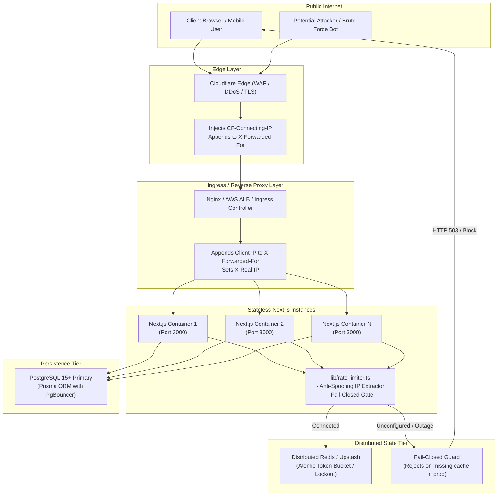

# Production Deployment Guide & Security Runbook: espressivo ART

**Document Version:** 1.0.0  
**Classification:** Operational Security & Architecture Runbook  
**Target Environments:** Production (Docker, Kubernetes, AWS ECS, Fly.io, Vercel)  
**Security Level:** Production Hardened (OWASP ASVS Level 2, 152-FZ Compliant)

---

## 1. Architecture Overview

espressivo ART is a high-reliability, cloud-native web platform for international arts competitions and educational festivals. It is designed to scale horizontally across multiple stateless containers or serverless worker instances while maintaining strict security, state coordination, and data privacy invariants.



---

## 2. Production Deployment Requirements

### 2.1 Hardware & Runtime Specifications
- **Runtime:** Node.js 20.x LTS (Active Long Term Support).
- **Container Base:** `node:20-alpine` or `node:20-bookworm-slim`.
- **Compute Sizing (per replica):**
  - Minimum: 1 vCPU, 1 GB RAM.
  - Recommended: 2 vCPU, 2 GB RAM.
- **Autoscaling Target:** 60% CPU utilization or 70% memory threshold.
- **Minimum Replicas:** 2 containers (ensures zero-downtime rolling updates and high availability).

### 2.2 Database Requirements
- **Engine:** PostgreSQL 15 or higher (Amazon RDS, Supabase, Neon, or self-hosted).
- **Connection Pooling:** Mandatory in containerized/serverless environments (e.g. PgBouncer or Supabase Transaction Pooler).
- **SSL / TLS:** Encrypted connections mandatory (`sslmode=require` or `sslmode=verify-full`).
- **Prisma Migrations:** Execute `npx prisma migrate deploy` during CD pipeline before traffic switchover, never on container startup in horizontal replicas.

---

## 3. Environment Variables Reference

| Variable | Required in Prod | Format / Type | Default | Description & Security Constraints |
| :--- | :--- | :--- | :--- | :--- |
| `NODE_ENV` | **YES** | Enum (`production`) | `development` | Strict production mode. Disables demo credentials, activates fail-closed rate limiting, enables secure cookies (`SameSite=Lax; Secure; HttpOnly`). |
| `DATABASE_URL` | **YES** | URI (`postgresql://...`) | — | Connection string to PostgreSQL primary / pooler with SSL. |
| `JWT_SECRET` | **YES** | String (>= 32 chars) | — | Cryptographic secret for signing session tokens with HS256/jose. Must be a high-entropy CSPRNG string. Application fails fast at boot if missing or <32 characters. |
| `NEXT_PUBLIC_APP_URL` | **YES** | HTTPS URL | — | Canonical base domain (e.g. `https://espressivo.art`). Used for OAuth, verification redirects, and QR code diplomas. |
| `UPSTASH_REDIS_REST_URL` | **Conditional** | HTTPS URL | — | Upstash Redis REST endpoint for distributed rate limiting. Required if `REDIS_URL` is omitted. |
| `UPSTASH_REDIS_REST_TOKEN`| **Conditional** | Secret Token | — | Bearer token for Upstash Redis REST API. |
| `REDIS_URL` | **Conditional** | URI (`redis://...`) | — | Standard Redis connection string. Required if Upstash is omitted. |
| `ALLOW_INSECURE_IN_MEMORY_RATE_LIMITER` | NO | Boolean (`true`/`false`) | `false` | **Emergency Staging Only**: Allows in-memory fallback in production. Produces critical log alarms. Never allow in live production. |
| `TRUSTED_PROXY_COUNT` | **YES** | Integer (>= 1) | `1` | Number of trusted reverse proxy hops in front of Next.js. Used to extract genuine client IP from rightmost hop. |
| `TRUSTED_PROXY_HEADER` | Recommended | String | `""` | Validated single header from trusted edge proxy (e.g. `cf-connecting-ip`, `true-client-ip`, or `x-real-ip`). |
| `TRUSTED_PROXIES` | Optional | Comma-separated IPs | `""` | Comma-separated list of upstream proxy IP addresses or subnets. |
| `MOCK_PAYMENT_SECRET` | NO | String (>= 32 chars) | — | Secret key for mock gateway (strictly disabled in production unless testing in isolated sandbox). |
| `ENABLE_MOCK_CHECKOUT` | NO | Boolean | `false` | Unconditionally disabled in production. Overrides are ignored by production routes. |
| `DEFAULT_TEACHER_COMMISSION_RATE` | NO | Float (0.0 - 1.0) | `0.20` | Partner commission rate for teacher referrals (20%). |

---

## 4. Distributed Rate Limiting & Fail-Closed Architecture

### 4.1 The Horizontal Scaling Problem
In a clustered or serverless production environment (Kubernetes, AWS ECS, Fly.io, Vercel), each container process maintains an independent memory space. If an in-memory `Map` is used:
1. An attacker can distribute brute-force attempts across different pods or serverless instances, multiplying allowed attempts by the number of active pods.
2. Autoscaling events, rolling deployments, or restarts flush the rate limit state, granting attackers an immediate reset.

### 4.2 Pluggable Storage Backends (`lib/rate-limiter.ts`)
The unified `RateLimiter` module supports three operational storage drivers:
- **`UpstashRedisRateLimiterStore` (Recommended):** Zero-dependency REST-based client using native `fetch`. Ideal for serverless, edge runtimes, and Docker pods without TCP connection exhaustion.
- **`GenericRedisRateLimiterStore`:** Standard TCP/TLS Redis client adapter for managed clusters (AWS ElastiCache, Redis Enterprise, Redis Sentinel).
- **`MemoryRateLimiterStore`:** Local sliding-window in-memory store with automated TTL pruning, reserved exclusively for local development and unit tests.

### 4.3 Fail-Closed Security Policy
When `NODE_ENV=production`:
- If neither Upstash (`UPSTASH_REDIS_REST_URL` & `UPSTASH_REDIS_REST_TOKEN`) nor Redis (`REDIS_URL`) is configured, the application **refuses to operate in a fake-security state**.
- The `FailClosedRateLimiterStore` is engaged:
  - All rate-limited entrypoints (e.g. `POST /api/auth/login`) immediately respond with **HTTP 503 Service Unavailable**:
    ```json
    {
      "error": "Служба авторизации временно недоступна. Пожалуйста, повторите попытку позже.",
      "code": "SERVICE_UNAVAILABLE",
      "retryAfter": 60
    }
    ```
  - A high-severity alarm is logged to `stderr`:
    ```
    [RateLimiter:fail-closed] CRITICAL: Rate limiter distributed storage (Redis/Upstash) is not configured in production.
    ```
- **Staging / Preview Override:** If explicitly required for ephemeral preview environments without Redis, set `ALLOW_INSECURE_IN_MEMORY_RATE_LIMITER="true"`. This will log a loud `[SECURITY WARNING]` on every boot and request.

---

## 5. Reverse Proxy & Anti-Spoofing Architecture

### 5.1 The `X-Forwarded-For` Vulnerability
A common vulnerability in web applications is trusting the leftmost IP in the `X-Forwarded-For` header:
```
X-Forwarded-For: <spoofed_client_ip>, <actual_client_ip>, <proxy_1_ip>
```
An attacker simply sends:
```http
POST /api/auth/login HTTP/1.1
Host: espressivo.art
X-Forwarded-For: 1.2.3.4
```
A naive server taking `split(',')[0]` reads `1.2.3.4`. By randomizing this header on each request (`1.2.3.5`, `1.2.3.6`), the attacker completely bypasses IP rate limiting.

### 5.2 Hop-Count & Header Validation Defense
Reverse proxies (Nginx, Cloudflare, AWS ALB) **always append** the client IP from the incoming TCP connection to the **end** of the `X-Forwarded-For` list.

`lib/rate-limiter.ts` implements a multi-tier anti-spoofing algorithm:
1. **Tier 1 — Validated Single Header (Highest Precedence):**
   When `TRUSTED_PROXY_HEADER` is configured (e.g. `cf-connecting-ip` on Cloudflare or `true-client-ip`), the edge proxy strips any user-supplied header and injects the verified TCP remote address.
2. **Tier 2 — Rightmost Hop Count (`TRUSTED_PROXY_COUNT`):**
   If `TRUSTED_PROXY_COUNT=1` (standard single proxy):
   $$\text{targetIndex} = \text{hops.length} - 1$$
   The rightmost IP added by your reverse proxy is selected. Any client-injected IPs on the left are completely discarded.
   If `TRUSTED_PROXY_COUNT=2` (Cloudflare -> Nginx -> Next.js):
   $$\text{targetIndex} = \text{hops.length} - 2$$
3. **Tier 3 — Port Stripping & IP Syntax Validation:**
   Strips ports (`198.51.100.42:54321` $\to$ `198.51.100.42`, `[2001:db8::1]:8080` $\to$ `2001:db8::1`) and validates against IPv4/IPv6 regex. Rejects malformed strings or SQLi payloads, falling back to `"unknown-client"`.

### 5.3 Proxy Configuration Blueprints

#### Architecture A: Cloudflare Edge + Container
- Set in `.env`:
  ```ini
  TRUSTED_PROXY_HEADER="cf-connecting-ip"
  TRUSTED_PROXY_COUNT="1"
  ```
- Cloudflare Dashboard:
  - SSL/TLS: **Full (Strict)**.
  - Web Application Firewall (WAF): Enabled.
  - Transform Rules: Ensure `CF-Connecting-IP` is passed to origin.

#### Architecture B: Nginx Reverse Proxy + Next.js
- Set in `.env`:
  ```ini
  TRUSTED_PROXY_HEADER="x-real-ip"
  TRUSTED_PROXY_COUNT="1"
  ```
- `nginx.conf` snippet:
  ```nginx
  server {
      listen 443 ssl http2;
      server_name espressivo.art;

      ssl_certificate /etc/letsencrypt/live/espressivo.art/fullchain.pem;
      ssl_certificate_key /etc/letsencrypt/live/espressivo.art/privkey.pem;

      location / {
          proxy_pass http://127.0.0.1:3000;
          proxy_http_version 1.1;

          # Anti-spoofing headers
          proxy_set_header Host $host;
          proxy_set_header X-Real-IP $remote_addr;
          proxy_set_header X-Forwarded-For $proxy_add_x_forwarded_for;
          proxy_set_header X-Forwarded-Proto $scheme;
      }
  }
  ```

#### Architecture C: Multi-Tier (Cloudflare -> AWS ALB -> Next.js ECS)
- Cloudflare passes traffic to AWS Application Load Balancer.
- Set in `.env`:
  ```ini
  TRUSTED_PROXY_HEADER="cf-connecting-ip"
  TRUSTED_PROXY_COUNT="2"
  ```

---

## 6. Continuous Integration & Workflow Hardening

GitHub Actions (`.github/workflows/ci.yml`) is hardened according to DevSecOps standards:

```yaml
on:
  push:
    branches:
      - master
      - 'fix/**'
      - 'feat/**'
      - 'security/**'
  pull_request:
    branches:
      - master

permissions:
  contents: read

concurrency:
  group: ${{ github.workflow }}-${{ github.ref }}
  cancel-in-progress: true
```

### Key Security Invariants in CI:
1. **Push Triggers on `fix/**` & `security/**`:** Ensures developers get immediate CI test feedback on branch pushes before opening pull requests.
2. **Least Privilege (`permissions: contents: read`):** Restricts the default `GITHUB_TOKEN` to read-only repository access, mitigating risks from compromised dependencies.
3. **Environment Isolation:**
   - Test suites execute under `NODE_ENV=test` with step-scoped variables (`ENABLE_MOCK_CHECKOUT: "true"`).
   - The production build step (`npm run build`) strictly enforces `NODE_ENV=production` with `ENABLE_DEMO_ACCOUNTS: "false"` and `ENABLE_MOCK_CHECKOUT: "false"`. Test backdoors cannot leak into production bundles.
4. **Deterministic Dependencies:** `npm ci` verifies `package-lock.json` hash integrity without floating dependency upgrades.

---

## 7. Production Verification & Runbook

### 7.1 Verify Distributed Rate Limiting
Execute 6 rapid requests to test the brute-force lockout:
```bash
EMAIL="test-rate-limit@example.com"
URL="https://espressivo.art/api/auth/login"

for i in {1..6}; do
  echo "--- Attempt $i ---"
  curl -s -i -X POST "$URL" \
    -H "Content-Type: application/json" \
    -d "{\"email\":\"$EMAIL\",\"password\":\"wrongpassword\"}" | head -n 1
done
```
**Expected Result:**
- Attempts 1–5: `HTTP/1.1 401 Unauthorized` (`INVALID_CREDENTIALS`).
- Attempt 6: `HTTP/1.1 429 Too Many Requests` (`RATE_LIMITED` with `retryAfter: 900`).

### 7.2 Verify Anti-Spoofing Protection
Attempt to bypass rate limiting by injecting arbitrary `X-Forwarded-For` spoofed IPs:
```bash
# Attempt from same machine with randomized spoofed header:
curl -s -i -X POST "$URL" \
  -H "Content-Type: application/json" \
  -H "X-Forwarded-For: 1.2.3.4" \
  -d "{\"email\":\"$EMAIL\",\"password\":\"wrongpassword\"}" | head -n 1
```
**Expected Result:** The server extracts the rightmost hop (your real IP) and continues to return `HTTP 429 Too Many Requests`. The spoofed `1.2.3.4` is ignored.

### 7.3 Verify Fail-Closed Policy (Sandbox / Staging)
1. Temporarily unset `UPSTASH_REDIS_REST_URL` and `REDIS_URL`.
2. Send a login request:
   ```bash
   curl -s -i -X POST "$URL" \
     -H "Content-Type: application/json" \
     -d "{\"email\":\"admin@espressivo.art\",\"password\":\"anypass\"}"
   ```
3. **Expected Result:** `HTTP/1.1 503 Service Unavailable` with `code: "SERVICE_UNAVAILABLE"`.

---

## 8. Incident Response & Troubleshooting

### Scenario A: Redis Cluster Outage
- **Symptoms:** Users receive `HTTP 503 Service Unavailable` on authentication.
- **Immediate Action:**
  1. Check Redis / Upstash status dashboard.
  2. If emergency temporary authentication is required during an active competition, deploy with `ALLOW_INSECURE_IN_MEMORY_RATE_LIMITER="true"` while single-instance or pinned to a sticky session.
  3. Restore Redis connectivity and unset the insecure override.

### Scenario B: Proxy Misconfiguration (All Users Throttled)
- **Symptoms:** Multiple distinct users simultaneously report `HTTP 429 Too Many Requests`.
- **Cause:** `TRUSTED_PROXY_COUNT` is set too high, causing Next.js to extract the internal proxy/NAT IP instead of the client IP.
- **Immediate Action:**
  1. Inspect incoming request logs for `x-forwarded-for` and proxy headers.
  2. If behind a single proxy (ALB/Nginx), ensure `TRUSTED_PROXY_COUNT="1"`.
  3. If using Cloudflare, set `TRUSTED_PROXY_HEADER="cf-connecting-ip"`.
