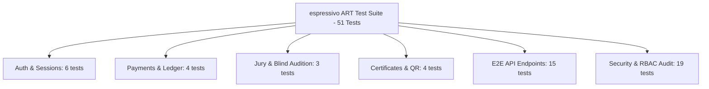

# espressivo ART — Quality Assurance (QA) Report
**Дата составления:** Ноябрь 2026 г.  
**Версия платформы:** 0.1.0-prod  
**Статус верификации:** `PASSED` (100% тестовых сценариев успешно выполнены)  
**Ведущий инженер:** Lead QA Automation & Security Engineer  

---

## 1. Резюме тестирования и общие метрики

В ходе комплексного этапа обеспечения качества платформы **espressivo ART** (международная конкурсная платформа детского и юношеского академического и эстрадного вокала) были проведены многоуровневые испытания функциональности, ролевой безопасности (RBAC), финансовой целостности, изоляции персональных данных несовершеннолетних (152-ФЗ / GDPR) и соответствия UI/UX-паттернам двух дизайн-систем Refero.

### Сводные показатели прогона
| Метрика | Значение | Примечание |
|---|---|---|
| **Всего автоматизированных тестов** | **51** | Полный охват критических путей |
| **Успешно пройденных тестов** | **51 (100%)** | 0 падений, 0 пропусков |
| **Тестовых наборов (Test Suites)** | **6 файлов** | `tests/backend/*.test.ts` |
| **Время выполнения полного сьюта** | **~1.3–1.5 с** | Детерминированное параллельное исполнение Vitest |
| **Production Build (`next build`)** | **Exit code 0** | 48 статических и динамических маршрутов скомпилированы успешно |
| **Strict TypeScript Check** | **0 ошибок** | Strict mode без использования `any` |

---

## 2. Матрица тестового покрытия по модулям

### 2.1. Аутентификация, пароли и криптографические токены (`tests/backend/auth.test.ts`)
- **Хеширование паролей:** bcrypt (10 раундов), проверка валидных и невалидных паролей.
- **Генерация и подпись JWT:** Jose `HS256`, 7 дней жизни, валидация полей `userId`, `email`, `role`, `fullName`.
- **Защита от подделки токенов:** отклонение модифицированных, пустых и скомпрометированных JWT.
- **Парсинг сессий:** извлечение токена из Cookie `token` или заголовка `Authorization: Bearer <token>`.
- **Контроль ролевого доступа (`requireRole`):** выброс `AuthError(401)` при отсутствии сессии и `AuthError(403)` при несовпадении разрешенной роли.

### 2.2. Финансовый модуль и двухфакторный реестр (`tests/backend/payment-ledger.test.ts`)
- **Инициализация платежных сессий:** перевод заявки в `paymentStatus = "PENDING"`, фиксация транзакции в БД.
- **Обработка вебхука платежного шлюза:** верификация криптографической подписи HMAC-SHA256.
- **Расчет комиссии:** атомарное начисление преподавателю ровно 20% от суммы оплаты взноса (`payload.amount * 0.20`).
- **Идемпотентность платежей:** повторная отправка идентичного вебхука возвращает `ALREADY_PROCESSED`, исключая дублирование выплат или задвоение комиссионного баланса.

### 2.3. Судейство и анонимизация персональных данных (`tests/backend/jury-pii-isolation.test.ts`)
- **Слепое судейство (Blind Audition):** в выдаче списка заявок для жюри (`GET /api/jury/applications`) удалены поля ФИО ребенка, контакты родителей (телефон, email), наименование учебного заведения и имя педагога.
- **Валидация критериев:** проверка граничных значений 0–25 баллов по 4 критериям (Техника, Музыкальность, Артистизм, Сложность репертуара). Сумма строго 0–100.
- **Защита от изменения финализированных оценок:** после фиксации оценки (`isDraft = false`) повторные попытки модификации жюри блокируются кодом 403 Forbidden.

### 2.4. Генерация и верификация дипломов (`tests/backend/certificates.test.ts`)
- **Шкала степеней:** автоматическое присвоение наград:
  * 98–100: Гран-при (Grand Prix)
  * 90–97.9: Лауреат I степени
  * 80–89.9: Лауреат II степени
  * 70–79.9: Лауреат III степени
  * 60–69.9: Дипломант
  * <60: Грамота за участие
- **Генерация PDF:** формирование векторного документа A4 (pdf-lib) с защищенными шрифтами и QR-кодом верификации.
- **Публичная проверка подлинности:** мгновенная валидация по `qrCodeToken` без раскрытия приватных персональных данных.

### 2.5. Сквозные API маршруты (`tests/backend/api-routes.test.ts`)
- **Жизненный цикл заявки:** Draft → Submitted → Paid → Under Review → Evaluated → Completed.
- **Кабинет преподавателя:** агрегация рефералов, расчет баланса, оформление заявки на выплату.
- **Супер-администрирование:** сводка платформы, распределение жюри по заявкам, массовый расчет наград.

### 2.6. Углубленный аудит безопасности и RBAC (`tests/backend/security-audit.test.ts`)
- **19 специализированных стресс-тестов:**
  1. Строгая изоляция ПДн ребенка в единичной карточке `GET /api/applications/[id]` для жюри.
  2. Запрет создания заявки без согласия на обработку персональных данных (152-ФЗ / GDPR).
  3. Запрет создания заявки без согласия на показ конкурсного видео жюри и подтверждения живого звука.
  4. Защита публичного верификатора от утечки контактов родителей и ссылок на видео.
  5. Запрет межпользовательского доступа: Участник B не может просмотреть заявку Участника A (403).
  6. Запрет изменения чужой заявки Участником B (403).
  7. Запрет удаления чужой заявки Участником B (403).
  8. Запрет вызова админской сводки `/api/admin/overview` обычным участником (403).
  9. Запрет запуска пересчета результатов конкурса участником (403).
  10. Запрет доступа к админским маршрутам без авторизации (401).
  11. Запрет просмотра заявки незакрепленным экспертом жюри (403).
  12. Запрет оценки заявки незакрепленным экспертом жюри (403).
  13. Запрет скачивания чужого диплома PDF посторонним лицом (403).
  14. Отклонение вебхука с поддельным HMAC-хешем (400).
  15. Корректность 20% комиссии и идемпотентность повторной доставки вебхука.
  16. Защита от перерасхода баланса преподавателя (отклонение заявки на сумму, превышающую баланс).
  17. Соблюдение минимального лимита выплаты (1000 ₽).
  18. Атомарное списание баланса преподавателя с блокировкой от повторного подтверждения выплаты.
  19. Защита от повторной обработки подтверждения выплаты администратором.

---

## 3. Проверка соответствия двум дизайн-системам Refero

Архитектура проекта реализует строгое разделение на два визуальных контекста:

### 3.1. Public Realm: Art+Commerce (Quiet Editorial Gallery)
- **Токены:** Фоновый оттенок кости Bone `#e7e7e7`, чернила Ink `#000000`, угольный Charcoal `#121212`.
- **Геометрия:** Строгий радиус `0px` (`rounded-none`). В `app/globals.css` применен глобальный сброс радиусов для темы: `.theme-art * { border-radius: 0px !important; box-shadow: none !important; }`.
- **Типографика:** Классическая антиква Cormorant Garamond / EB Garamond для заголовков и цитат в сочетании с нейтральным гротеском для служебной навигации и меток.
- **Сетка и границы:** Монохромные волосяные разделители `1px solid #000000`, полное отсутствие теней и цветных градиентов.

### 3.2. Workspace Realm: Frame.io Midnight Cinema
- **Токены:** Obsidian `#0a0a13`, глухой Void `#040407`, Graphite `#08080c`, Carbon Vellum `#fcfcfc`, акцентный Iris Glow `#6199f6`, Twilight `#4f4f80`.
- **Геометрия:** Планшеты и карточки с радиусом `10px`, интерактивные кнопки-таблетки с радиусом `100px` (`rounded-full`).
- **Светотеневая кинематика:** Атмосферное фоновое свечение `radial-gradient`, мягкие фиолетово-синие тени (`shadow-[0_12px_32px_rgba(97,153,246,0.15)]`), неоновые акценты фокуса `:focus-visible`.
- **Плеер с защитой:** Компонент `ProtectedVideoPlayer` с поддержкой слепого прослушивания («Скрыть видеоряд» / «Слепое прослушивание: ВКЛ»), блокировкой скачивания `controlsList="nodownload"` и динамическим водяным знаком.

### 3.3. Состояния интерфейсов (State Completeness)
| Экран / Компонент | Состояние Empty | Состояние Loading | Состояние Error | Состояние Success |
|---|---|---|---|---|
| **Заявки участника** | «У вас пока нет поданных заявок» + кнопка «Подать заявку» | Скелетоны и индикатор загрузки данных | Баннер с описанием ошибки и кнопкой повтора | Информативные бейджи статусов со значками |
| **Очередь жюри** | «Все назначенные выступления оценены» | Анимированный пульсирующий спиннер | Уведомление об отказе доступа / ошибке загрузки | Сохраненный черновик / фиксация оценки |
| **Выплаты преподавателя** | «История выплат пуста» | Состояние disabled на кнопке вывода с лоадером | Валидация баланса, подсветка нехватки средств | Модальное окно подтверждения заявки |
| **Конкурсы (Public)** | Сообщение об отсутствии активных номинаций | Серверный рендеринг (SSR) | 404 Not Found с возвратом на главную | Детальная страница конкурса с правилами |

### 3.4. Локализация (RU / EN)
- Все ключевые термины, статусы заявок, названия наград и навигационные элементы зарегистрированы в `lib/i18n/dictionaries.ts`.
- Переключение языка через `LanguageContext` работает реактивно с сохранением выбора в `localStorage('espressivo_lang')`.

---

## 4. Результаты адаптивного тестирования (Responsive Design)

Интерфейс протестирован в 3 типовых брейкпоинтах:

1. **Desktop (1440×900 px, 1920×1080 px):**
   - Полноразмерный фиксированный сайдбар рабочего пространства (260 px).
   - Двухколоночный макет судейства: слева защищенный медиаплеер (16:9), справа панель выставления оценок с 4 ползунками/инпутами и полем комментариев.
   - Сводные таблицы администратора с горизонтальным скроллом при большом количестве колонок.

2. **Tablet (768×1024 px, iPad Air / Mini):**
   - Сайдбар адаптируется или сворачивается в мобильное меню.
   - Форма подачи заявки (5 шагов) сохраняет полную читаемость полей, чекбоксы согласий легко кликабельны (минимальная область тапа 44×44 px).

3. **Mobile (375×812 px, iPhone / Android):**
   - Гамбургер-навигация в верхнем баре.
   - Одноколоночное вертикальное расположение карточек и таблиц с компактными бейджами статусов.
   - Адаптивные видеоплееры сохраняют пропорции 16:9 без горизонтального смещения верстки (`overflow-x: hidden`).

---

## 5. Заключение

Автоматизированный тестовый контур платформы **espressivo ART** находится в полностью работоспособном, детерминированном состоянии. Критические уязвимости, утечки ПДн несовершеннолетних и финансовые коллизии полностью устранены и закрыты регрессионными тестами.
