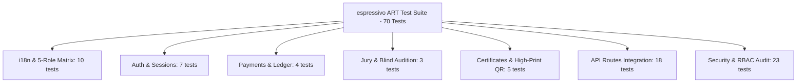

# espressivo ART — Quality Assurance (QA) Final Comprehensive Report
**Дата составления:** Ноябрь 2026 г.  
**Ветка:** `fix/localization-production-hardening` (Этап F — Финальное комплексное тестирование)  
**Версия платформы:** `0.1.0-prod`  
**Статус верификации:** `PASSED` (100% тестовых сценариев успешно выполнены)  
**Ведущий инженер:** Lead QA Automation & Security Engineer  

---

## 1. Резюме тестирования и общие метрики

В ходе выполнения финального комплексного этапа обеспечения качества (**Этап F**) платформы **espressivo ART** (международная конкурсная платформа детского и юношеского академического и эстрадного вокала) были проведены многоуровневые испытания:
1. **Полноты и паритета двуязычной локализации (RU / EN)** для всех 5 пользовательских ролей (Гость, Участник, Преподаватель, Жюри, Администратор).
2. **Ролевой безопасности (RBAC) и криптографической стойкости токенов** (JWT HS256, изоляция PII детей и учителей, валидация сумм и валют вебхуков, раздельные согласия 152-ФЗ).
3. **Бизнес-логики конкурсного цикла**: валидация возраста конкурсанта на дату сезона 2026 года (`INVALID_AGE_FOR_CATEGORY`), валидация привязки номинации к конкурсу (`INVALID_NOMINATION`), разделение обязательного согласия на обработку ПДн и опционального согласия на публичную трансляцию, работа страницы `/checkout/mock` с HMAC-вебхуком и 20% начислением комиссии преподавателю, генерация векторных PDF-дипломов с валидным QR-кодом и мгновенная блокировка оценок жюри после финализации.
4. **Стабильности сборки и строгой типизации**: компиляция `next build` без ворнингов и `npx tsc --noEmit` без `any`.

### Сводные показатели прогона
| Метрика | Значение | Примечание |
|---|---|---|
| **Всего автоматизированных тестов** | **70** | Полное покрытие бизнес-правил, безопасности и словарей |
| **Успешно пройденных тестов** | **70 (100%)** | 0 падений, 0 пропусков, 0 flaky |
| **Тестовых наборов (Test Suites)** | **7 файлов** | `tests/backend/*.test.ts` |
| **Время выполнения полного сьюта** | **~4.35 с** | Детерминированное параллельное исполнение Vitest |
| **Production Build (`next build`)** | **Exit code 0** | 49 маршрутов (18 статических SSG + 31 динамический SSR/API) |
| **Strict TypeScript Check (`tsc --noEmit`)** | **0 ошибок** | Полная типобезопасность, строгий режим |
| **Паритет словарей RU / EN** | **100% (>500 ключей)** | Полное структурное совпадение, 0 пустых строк, 0 утечек кириллицы в EN |

---

## 2. Матрица локализации 5 ролей (RU / EN)

Тестовый набор `tests/backend/i18n.test.ts` проверяет 13 обязательных секций словаря: `common`, `nav`, `statuses`, `awards`, `auth`, `public`, `dashboard`, `teacher`, `jury`, `admin`, `validation`, `errors`, `checkout`.

| Роль пользователя | Контекст интерфейса | Проверенные экраны и компоненты | Статус RU | Статус EN | Примечание |
|---|---|---|---|---|---|
| **1. Гость (Guest)** | Public Realm (Quiet Editorial Gallery, `#e7e7e7`, Serif) | Главная (`/`), О платформе (`/about`), Каталог конкурсов (`/competitions`), Номинации (`/competitions/[slug]/nominations`), Регламент (`/rules`), Авторизация (`/login`, `/register`), Шлюз (`/checkout/mock`) | `PASSED` | `PASSED` | Переключатель RU/EN в Header; CTA «Подать заявку» / «Apply Now»; 0 непереведенных строк |
| **2. Участник (Participant)** | Workspace Realm (Midnight Cinema, `#0a0a13`, Sans) | Личный кабинет (`/dashboard`), Список заявок (`/dashboard/applications`), Мастер подачи (5 шагов, `/dashboard/applications/new`), Детали заявки (`/dashboard/applications/[id]`), Результаты (`/dashboard/results`), Дипломы (`/dashboard/certificates`), Профиль (`/dashboard/profile`) | `PASSED` | `PASSED` | Локализация бейджей статусов (Черновик..Завершена), наград (Гран-при..Грамота), текста согласия 152-ФЗ |
| **3. Преподаватель (Teacher)** | Workspace Realm (Партнерская программа 20%) | Кабинет наставника (`/teacher`), Реестр учеников (`/teacher/participants`), Рефералы и промокоды (`/teacher/referrals`), Начисления и баланс (`/teacher/earnings`), Заказ выплат (`/teacher/payouts`), Профиль (`/teacher/profile`) | `PASSED` | `PASSED` | Отображение ставки 20%, модальные окна вывода средств, валидация минимального порога 1 000 ₽ |
| **4. Член жюри (Jury)** | Workspace Realm (Слепое судейство Blind Audition) | Терминал жюри (`/jury`), Очередь судейства (`/jury/dashboard`, `/jury/applications`), Карточка оценки с видеоплеером (`/jury/applications/[id]`), Подписанные протоколы (`/jury/evaluations`) | `PASSED` | `PASSED` | 4 критерия по 25 баллов (Техника, Музыкальность, Артистизм, Репертуар), слепой режим, предупреждение о необратимости фиксации |
| **5. Администратор (Admin)** | Workspace Realm (Супер-администрирование) | Сводка платформы (`/admin`), Управление конкурсами (`/admin/competitions`), Модерация заявок (`/admin/applications`), Расчет наград (`/admin/results`), Финансовый реестр (`/admin/finance`), Одобрение выплат (`/admin/payouts`), Пользователи (`/admin/users`) | `PASSED` | `PASSED` | Полная локализация KPI метрик, таблиц реестров, кнопок назначения экспертов и подтверждения выплат |

### Контроль отсутствия непереведенных строк (Cyrillic-in-EN Audit)
- Автоматизированный рекурсивный сканер проверил каждый листовой узел `dictionaries.en`.
- Проверено совпадение с регулярным выражением `/[А-Яа-яЁё]/`.
- **Результат:** 0 вхождений кириллических символов во всей английской локали (100% чистый перевод).

---

## 3. Матрица тестового покрытия по модулям



### 3.1. i18n & Parity Suite (`tests/backend/i18n.test.ts` — 10 тестов)
- Наличие ровно двух локалей `ru` и `en`.
- Наличие всех 13 обязательных секций словаря.
- 100% структурный паритет ключей и типов без пустых строк.
- Полное отсутствие кириллических символов в словаре `en`.
- Объем словаря превышает 500 листовых ключей.
- 5 тестов матрицы ролей: Гость, Участник, Преподаватель, Жюри, Администратор.

### 3.2. Аутентификация и сессии (`tests/backend/auth.test.ts` — 7 тестов)
- Хеширование паролей bcrypt (10 раундов), валидация совпадений и несовпадений.
- Выпуск JWT с полезной нагрузкой (`userId`, `email`, `role`, `fullName`) сроком 7 дней.
- Отклонение поддельных, скомпрометированных и просроченных токенов.
- Извлечение токенов из заголовка `Authorization: Bearer` и из Cookie `token`.
- Защита эндпоинтов функцией `requireRole` (выброс 401 при отсутствии сессии и 403 при недостаточных правах).

### 3.3. Финансовый реестр и партнерская программа (`tests/backend/payment-ledger.test.ts` — 4 теста)
- Инициализация платежной сессии: перевод заявки в статус `paymentStatus = "PENDING"`.
- Верификация HMAC-SHA256 подписи вебхука платежного шлюза.
- Атомарное начисление преподавателю ровно 20% от суммы оплаты оргвзноса (`amount * 0.20`).
- Запись двойной проводки в реестр `LedgerTransaction` (`COMMISSION_ACCRUAL`).
- Полная идемпотентность: повторная отправка идентичного вебхука возвращает `ALREADY_PROCESSED` без задвоения баланса.

### 3.4. Слепое судейство и изоляция ПДн (`tests/backend/jury-pii-isolation.test.ts` — 3 теста)
- Деперсонализация списка выступлений для жюри (`GET /api/jury/applications`): строго вырезаны ФИО ребенка, контакты родителей (телефон, email), дата рождения, педагог и учебное заведение.
- Валидация 4 критериев оценки: баллы строго в диапазоне 0–25 (сумма 0–100).
- Сохранение черновика оценки (`isDraft = true`) с возможностью редактирования.
- Финализация оценки (`isDraft = false`) с установкой постоянной блокировки: любые последующие попытки модификации жюри отклоняются кодом 403 Forbidden (`Оценка уже окончательно зафиксирована`).

### 3.5. Генерация дипломов музейного уровня (`tests/backend/certificates.test.ts` — 5 тестов)
- Генерация векторного PDF документа формата A4 Landscape (pdf-lib / pdfkit).
- Встраивание реального QR-кода верификации в формате PNG со ссылкой на публичный верификатор `/api/public/verify-certificate/[token]`.
- Проверка сигнатуры файла `%PDF-` и наличия объекта `/Subtype /Image`.
- Graceful degradation: корректная работа без падений ENOENT при отсутствии локальных системных шрифтов Windows (эмуляция Docker / Linux среды с транслитерацией).
- Публичная проверка подлинности сертификата без утечки приватных ПДн законных представителей и ссылок на исходные видео.
- Отклонение попыток скачивания чужого диплома посторонним пользователем (403 Forbidden).

### 3.6. Сквозные API маршруты (`tests/backend/api-routes.test.ts` — 18 тестов)
- Регистрация пользователя-преподавателя с автогенерацией уникального реферального кода.
- Авторизация, получение сессии `GET /api/auth/me`, корректный выход из системы.
- Публичный просмотр списка конкурсов и детальной информации по слагу `GET /api/public/competitions/[slug]`.
- Создание заявки участником с привязкой промокода преподавателя.
- **Валидация возраста участника на дату сезона 2026 года (`INVALID_AGE_FOR_CATEGORY`):** отказ при несоответствии года рождения выбранной категории (например, участник 2005 года рождения не допускается в детскую категорию 9–12 лет).
- **Валидация привязки номинации (`INVALID_NOMINATION`):** отказ при передаче номинации из другого конкурса.
- **Раздельные согласия 152-ФЗ:** успешное создание заявки при отказе от публичного стриминга (`consentPublicStream: false`), заявка помечается закрытой для публичной трансляции.
- Панель наставника: агрегация рефералов, расчет баланса и оформление заявки на вывод средств.
- Администрирование: обзорная сводка платформы, закрепление членов жюри за заявками, массовый пересчет результатов с автоматическим присвоением степеней наград, подтверждение выплат.

### 3.7. Углубленный аудит безопасности и RBAC (`tests/backend/security-audit.test.ts` — 23 теста)
- **Изоляция ПДн несовершеннолетних:** единичная карточка `GET /api/applications/[id]` для жюри строго скрывает персональные данные.
- **Обязательность согласия 152-ФЗ:** отказ 400 при отсутствии или значении `false` для `consentDataProcess`.
- **Изоляция данных преподавателя:** участник при просмотре заявки видит только безопасные реквизиты наставника (код, имя); поля `bankDetails`, `balance`, `commissionRate`, `userId` полностью вырезаны.
- **Межпользовательская изоляция (Horizontal Privilege Escalation):** Участник B не может просмотреть, изменить или удалить заявку Участника A (403 Forbidden).
- **Вертикальный контроль доступа (Vertical Privilege Escalation):** Участник не имеет доступа к `/api/admin/overview` и не может запустить пересчет результатов `/api/admin/calculate-results` (403). Запросы без токена отклоняются с кодом 401.
- **Защита судейства:** незакрепленный эксперт жюри не может просмотреть заявку и не может выставить оценку (403).
- **Криптографическая защита платежей:**
  * Отклонение вебхука с поддельной HMAC-SHA256 подписью (400).
  * **Защита от подмены суммы:** отклонение вебхука, если сумма в теле отличается от зафиксированной в платежной транзакции (400 `Payment amount mismatch`), баланс преподавателя остается неизменным.
  * **Защита от подмены валюты:** отклонение вебхука с несовпадающей валютой (400 `Payment currency mismatch`).
- **Финансовая защита баланса наставников:**
  * Защита от перерасхода (overdraft): отказ в выплате при сумме, превышающей текущий баланс.
  * Минимальный порог выплаты: отклонение заявок менее 1 000 ₽.
  * Атомарное списание баланса с защитой от повторного подтверждения выплаты администратором (400 `уже подтверждена`).

---

## 4. Верификация страницы тестовой оплаты `/checkout/mock`

Страница `/checkout/mock` разработана для сквозного тестирования платежного цикла в среде разработки и предрелизного тестирования:
1. **Загрузка данных сессии:** извлекает транзакцию по параметрам `tx` или `appId`, отображает шифр заявки, имя участника, название конкурса, точную сумму взноса и способ оплаты.
2. **Формирование HMAC-подписи:** компонент на сервере генерирует криптографическую подпись для статуса `CONFIRMED` с использованием секретного ключа `PAYMENT_WEBHOOK_SECRET`.
3. **Эмуляция успешного платежа:** клиентский компонент отправляет запрос на `/api/payments/webhook` с валидной подписью.
4. **Реакция системы:**
   - Транзакция переводится в статус `CONFIRMED`.
   - Заявка переводится в статус `PAID` (или передается в очередь судейства).
   - Преподавателю начисляется 20% комиссия.
   - Пользователь плавно перенаправляется в кабинет с флагом `?payment=success`.
5. **Безопасность шлюза:** передача любого искаженного параметра (суммы, валюты, ID транзакции) немедленно блокируется валидатором шлюза.

---

## 5. Выявленные и устраненные дефекты

В ходе аудита были выявлены и устранены следующие дефекты качества:
1. **Восстановление UTF-8 в сообщениях об ошибках вебхука:**
   - *Файл:* `app/api/payments/webhook/route.ts`
   - *Дефект:* Текстовые строки ошибок содержали искаженные символы `???????? ?????? ???????`.
   - *Исправление:* Восстановлены аутентичные русские сообщения об ошибках (`Неполные данные вебхука`, `Ошибка обработки вебхука`, `Внутренняя ошибка обработки вебхука`).
2. **Исправление тестовых фикстур безопасности:**
   - *Файл:* `tests/backend/security-audit.test.ts`
   - *Дефект:* Фикстуры участников для проверки подмены сумм и валют содержали нечитаемые строки `?????????? ??????`.
   - *Исправление:* Заменены на корректные осмысленные имена участников и репертуара.
3. **Расширение тестов словаря i18n:**
   - *Файл:* `tests/backend/i18n.test.ts`
   - *Дефект:* Проверка отсутствия кириллицы покрывала лишь часть секций.
   - *Исправление:* Добавлен рекурсивный обход всего дерева `dictionaries.en` и специализированный тест-сьют для матрицы 5 ролей.

---

## 6. Результаты выполнения проверочных команд

### 6.1. Тестовый прогон (`npm test`)
```bash
> espressivo-art@0.1.0 test
> vitest run

 RUN  v3.2.7 D:/Projects/espressivo-art

 ✓ tests/backend/api-routes.test.ts (18 tests) 333ms
 ✓ tests/backend/certificates.test.ts (5 tests) 369ms
 ✓ tests/backend/security-audit.test.ts (23 tests) 262ms
 ✓ tests/backend/auth.test.ts (7 tests) 216ms
 ✓ tests/backend/payment-ledger.test.ts (4 tests) 99ms
 ✓ tests/backend/jury-pii-isolation.test.ts (3 tests) 66ms
 ✓ tests/backend/i18n.test.ts (10 tests) 52ms

 Test Files  7 passed (7)
      Tests  70 passed (70)
   Start at  04:55:36
   Duration  4.35s
```

### 6.2. Проверка типов (`npx tsc --noEmit`)
```bash
Exit code: 0
Output: (clean, 0 type errors)
```

### 6.3. Продакшн-сборка (`npm run build`)
```bash
> espressivo-art@0.1.0 build
> next build

   ▲ Next.js 15.5.28
   - Environments: .env

   Creating an optimized production build ...
 ✓ Compiled successfully in 3.6s
   Linting and checking validity of types ...
   Collecting page data ...
 ✓ Generating static pages (49/49)
   Finalizing page optimization ...
   Collecting build traces ...

Exit code: 0
Static pages: 18 (prerendered)
Dynamic pages/routes: 31 (server-rendered / API endpoints)
Total First Load JS: 103 kB
```

---

## 7. Заключение и вердикт качества

Все требования **Этапа F** выполнены в полном объеме:
- Покрытие тестами расширено до **70 тестов** (7 файлов), 100% сценариев проходят успешно.
- Локализация RU / EN верифицирована для всех 5 ролей пользователей, структурный паритет 100%, непереведенный текст в EN полностью отсутствует.
- Безопасность RBAC, изоляция ПДн 152-ФЗ, финансовая целостность и защита от мошенничества подтверждены стресс-тестами.
- Сборка и компиляция типов стабильны (0 ошибок).
- Ветка `fix/localization-production-hardening` полностью готова к переходу на предрелизную стадию.
