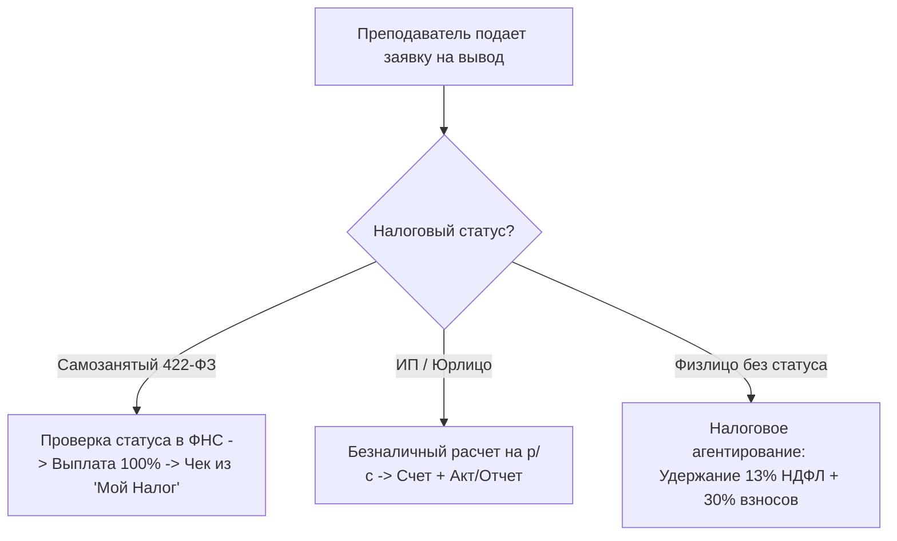

# Положение о партнерской программе для преподавателей и порядке выплаты агентского вознаграждения
**Платформа**: Международная конкурсная платформа **espressivo ART**  
**Проект**: *espressivo VOCAL — Young Talents*  
**Редакция**: 1.0 от 01 ноября 2026 года  
**Статус**: Официальное соглашение о партнерской программе (Агентский договор / Оферта)  

---

### 1. Правовая природа отношений и предмет Соглашения

1.1. Настоящее Положение регулирует условия участия преподавателей, музыкальных педагогов, концертмейстеров и руководителей творческих коллективов (далее — «Преподаватель» / «Партнер») в Партнерской программе международной платформы **espressivo ART** (далее — «Платформа»), администрируемой ООО «Эспрессиво АРТ» (далее — «Организатор»).

1.2. По своей гражданско-правовой природе отношения Сторон квалифицируются как **Агентский договор** в соответствии с главой 52 Гражданского кодекса РФ (ст. 1005–1011 ГК РФ) либо договор возмездного оказания услуг по привлечению и информационному сопровождению участников (ст. 779 ГК РФ).

1.3. В рамках Партнерской программы Преподаватель совершает по поручению Организатора юридические и фактические действия по популяризации конкурсов Платформы, привлечению талантливых исполнителей (своих учеников) к участию в Международном конкурсе «espressivo VOCAL — Young Talents» и их методическому наставничеству, а Организатор обязуется выплачивать Преподавателю агентское вознаграждение в размере и порядке, установленных настоящим Положением.

---

### 2. Размер вознаграждения и порядок начисления

2.1. Размер агентского вознаграждения Преподавателя составляет **20% (двадцать процентов)** от суммы фактически оплаченного организационного взноса за каждую конкурсную заявку, поданную с использованием персонального промокода или уникальной реферальной ссылки Преподавателя.

2.2. **Механизм фиксации атрибуции**:
- В личном кабинете Преподавателя формируется уникальный промокод (например, `ELENA-VOCAL`) и веб-ссылка вида `https://espressivo.art/ref/ELENA-VOCAL`.
- При переходе родителя по ссылке устанавливается 30-дневный файл cookie атрибуции. Если родитель вводит промокод вручную при оформлении заявки, ручной ввод имеет приоритет.

2.3. **Момент начисления и учет в Double-Entry Ledger**:
- Вознаграждение начисляется на виртуальный баланс Преподавателя в режиме реального времени в момент получения подтверждения успешной оплаты взноса от платежного шлюза (вебхук `payment.succeeded`).
- Каждая операция фиксируется в неизменяемом журнале транзакций (`LedgerTransaction`) с двойной записью.

2.4. **Политика возвратов и удержаний (Clawback Policy)**:
- В случае аннулирования заявки и возврата организационного взноса родителю (по основаниям ст. 32 ЗоЗПП) ранее начисленная комиссия 20% автоматически сторнируется с баланса Преподавателя.
- В случае если баланс Преподавателя становится отрицательным, возникшая задолженность погашается за счет последующих начислений за новых участников.

---

### 3. Регламент выплат и холдирующий период

3.1. **Минимальная сумма выплаты**: Запрос на выплату вознаграждения может быть сформирован Преподавателем при достижении доступного баланса не менее **1 000 (одной тысячи) рублей 00 копеек**.

3.2. **Холдирующий период (Chargeback Buffer)**:
- Начисленное вознаграждение находится в статусе «В обработке (Холдинг)» в течение **7 (семи) календарных дней** с момента оплаты заявки.
- Данный период необходим для исключения мошеннических операций, чарджбэков по банковским картам и урегулирования возможных технических отказов видеозаписей. По истечении 7 дней сумма переходит в статус «Доступно к выводу».

3.3. **Срок обработки заявки на вывод**: Организатор проверяет заявку на вывод средств и производит перечисление денежных средств в срок **не более 3 (трех) рабочих дней** с момента подачи заявки в личном кабинете.

---

### 4. Налоговый статус Преподавателя и фискальные требования

Организатор строго соблюдает налоговое законодательство Российской Федерации. Порядок выплаты и налоговые последствия напрямую зависят от официально заявленного налогового статуса Преподавателя:

#### 4.1. Статус «Самозанятый» (Плательщик НПД по Федеральному закону № 422-ФЗ) — РЕКОМЕНДУЕМЫЙ:
1. Преподаватель зарегистрирован в налоговом органе в качестве плательщика налога на профессиональный доход.
2. Перед осуществлением каждой выплаты Организатор в автоматическом режиме проверяет актуальность статуса самозанятого через официальный API ФНС России (`https://npd.nalog.ru/api-open-npd/`).
3. При подтверждении статуса выплата производится в размере **100% начисленной суммы** без удержания НДФЛ и страховых взносов (в соответствии с частью 1 статьи 15 Федерального закона № 422-ФЗ).
4. **ИМПЕРАТИВНАЯ ОБЯЗАННОСТЬ ПРЕДОСТАВЛЕНИЯ ЧЕКА**:
   - В соответствии со статьей 14 Федерального закона № 422-ФЗ Преподаватель обязан сформировать в мобильном приложении «Мой налог» фискальный чек на полученную сумму вознаграждения, указав в качестве заказчика ООО «Эспрессиво АРТ» (ИНН 7701987654), с наименованием услуги: *«Агентское вознаграждение за привлечение участников на конкурс espressivo VOCAL»*.
   - Чек должен быть передан Организатору (путем загрузки ссылки или PDF-файла в личный кабинет либо отправки на `billing@espressivo.art`) **не позднее 9-го числа месяца, следующего за месяцем получения выплаты**.
   - *Последствия непредоставления чека*: в случае непредставления чека выплата признается доходом физического лица, а Организатор вправе приостановить дальнейшие выплаты и удержать из баланса Преподавателя сумму доначисленного НДФЛ (13%) и страховых взносов (30%).

#### 4.2. Статус «Индивидуальный предприниматель» (ИП) или Юридическое лицо:
1. Выплаты производятся в безналичном порядке на расчетный счет ИП/организации, открытый в российском банке.
2. Преподаватель самостоятельно исчисляет и уплачивает налоги в соответствии со своей системой налогообложения (УСН 6%, УСН 15% и др.).
3. По итогам отчетного периода Стороны подписывают Акт выполненных работ (Отчет агента). Допускается подписание через систему электронного документооборота (Диадок, СБИС) с использованием КЭП.

#### 4.3. Физические лица без статуса самозанятого или ИП:
1. В соответствии со статьей 226 Налогового кодекса РФ при выплате вознаграждения физическому лицу, не имеющему специального налогового статуса, Организатор признается **налоговым агентом** и обязан:
   - Исчислить и удержать из суммы вознаграждения налог на доходы физических лиц (**НДФЛ по ставке 13%** для резидентов РФ или 15% с суммы свыше 5 млн руб.);
   - Начислить и уплатить за счет собственных средств обязательные **страховые взносы по единому тарифу 30%** (в Социальный фонд России) в соответствии со ст. 425 НК РФ;
   - Передать персональные сведения о выплатах в налоговые органы и СФР.
2. Для осуществления выплаты физическому лицу Преподаватель обязан предоставить полные паспортные данные, адрес регистрации, номер ИНН и страховое свидетельство (СНИЛС).
3. Сумма к фактической выплате «на руки» физлицу рассчитывается за вычетом 13% НДФЛ.
4. *Рекомендация Организатора*: В целях оптимизации выплат Организатор рекомендует преподавателям оформить статус самозанятого в приложении «Мой налог» (процедура занимает не более 10 минут) и получать вознаграждение в полном объеме, уплачивая налог по льготной ставке 6%.

---

### 5. Дополнительные нематериальные поощрения педагогов

5.1. Помимо материального вознаграждения, каждый Преподаватель, чей ученик становится обладателем диплома Гран-при или Лауреата I, II, III степени:
- Получает официальное **Благодарственное письмо международного образца** («За высокое педагогическое мастерство и подготовку Лауреата Международного вокального конкурса espressivo VOCAL — Young Talents») с подписью председателя жюри и защитным QR-кодом;
- Упоминается в официальных наградных приказах и каталогах конкурса;
- При подготовке более 5 лауреатов получает именной сертификат члена Экспертно-педагогического совета Платформы с правом внеочередного рецензирования конкурсных программ.

---

### 6. Запрещенные практики и антифрод-контроль

Преподавателю категорически запрещается:
1. Распространять реферальные ссылки с использованием спам-рассылок (в мессенджерах, по электронной почте или в немодерируемых комментариях);
2. Вводить родителей в заблуждение относительно условий конкурса, гарантий получения лауреатских мест или размера оргвзноса;
3. Регистрировать фиктивные аккаунты или использовать украденные платежные реквизиты.

При выявлении признаков мошенничества Организатор блокирует личный кабинет Партнера с аннулированием начисленного баланса.

---

### 7. Срок действия и порядок изменения условий

7.1. Партнерская программа действует бессрочно с момента публикации настоящего Положения.

7.2. Организатор вправе в одностороннем порядке вносить изменения в настоящее Положение, уведомив Партнеров за 10 (десять) календарных дней путем публикации новой редакции на сайте Платформы по адресу `https://espressivo.art/legal/teacher-agreement` и направления уведомления в личном кабинете.

---

### 8. Реквизиты Организатора

**Общество с ограниченной ответственностью «Эспрессиво АРТ» (ООО «Эспрессиво АРТ»)**  
Юридический адрес: 101000, г. Москва, Чистопрудный бульвар, д. 12, стр. 2, оф. 405  
ОГРН: 1267700123456 | ИНН: 7701987654 | КПП: 770101001  
Банк: АО «ТБанк» | р/с: 40702810900000123456 | БИК: 044525974  
Отдел по работе с партнерами: `partners@espressivo.art` | Бухгалтерия: `billing@espressivo.art`  
